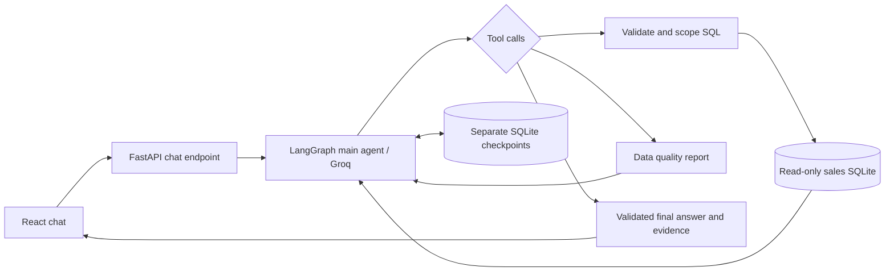

# RSG Sales Chat Assistant

A simple chat interface backed by a Groq-powered LangGraph main agent. Ask a sales question, then continue with “And the least?” or “Only in North?” The agent writes SQL, reads actual SQLite results, and replies with supporting figures and executed queries available under each answer.

## Run

Requirements: Python 3.11+, uv, Node.js 20.19+ or 22.12+, npm, and a Groq API key.

Backend, in terminal 1:

```powershell
cd rsg-backend
uv sync --locked
# If .env does not exist: Copy-Item .env.example .env
# Set GROQ_API_KEY in .env. Existing .env is preserved.
uv run uvicorn app.main:app --reload --host 127.0.0.1 --port 8000
```

Frontend, in terminal 2:

```powershell
cd rsg-frontend
npm ci
npm run dev
```

Open http://localhost:5173. API docs: http://127.0.0.1:8000/docs.

Groq is required for chat. There is no pattern-parser fallback. `GROQ_MODEL` defaults to `openai/gpt-oss-20b` (with `openai/gpt-oss-120b` as the recommended fallback). Restart the backend after changing `.env`. Old `AI_MODE` values are ignored.

The Python project root is `rsg-backend/`, containing its own `.venv`, `uv.lock`, configuration, CSV, tests, and `.gitignore`. React lives in `rsg-frontend/` with its own dependency lockfile and ignore rules. `npm run build` creates a production frontend that FastAPI can serve at port 8000 after restart.

## LangSmith tracing

Add these server-side settings to `rsg-backend/.env`, then restart the backend:

```dotenv
LANGSMITH_TRACING=true
LANGSMITH_API_KEY=your_langsmith_key
LANGSMITH_PROJECT=rsg-sales-assistant
LANGSMITH_ENDPOINT=https://api.smith.langchain.com
```

Graph steps, Groq calls and SQL/data-quality tools appear in that LangSmith project. Each turn carries `thread_id` metadata so conversations can be correlated. Traces include messages, SQL, and result sets. Keys are not added as trace metadata. Tracing is enabled only when the flag and key are both configured; it uses an explicit request context rather than changing global environment variables. Pending traces are flushed on application shutdown. See the [LangSmith tracing context reference](https://reference.langchain.com/python/langsmith/run_helpers/tracing_context).

## Existing agent model and architecture

I already had an existing agent model and architecture. I adapted its model/tool loop, SQL tools, query validation, conversation history, and checkpointing for this sales dataset under `rsg-backend/app/main_agent/`:

| Existing agent responsibility | Sales adaptation |
|---|---|
| `base_agent.py`: model, tools, prompt | `base_agent.py`: Groq model and tool binding |
| `graph.py`: running turns and recovering tool calls | `graph.py`: LangGraph model/tool loop, budgets, history and interrupted-call repair |
| `tools/query_tools.py`: model-written SQL and correction feedback | `tools.py`: SQL and data-quality tools with actual results and correction feedback |
| `query/sql_guard.py`: AST validation and scoped source substitution | `query.py`: sqlglot validation and completed-order source substitution |
| `memory/checkpointer.py`: thread checkpoints | LangGraph `AsyncSqliteSaver` in FastAPI lifespan |
| `schemas.py`: structured reply types | `main_agent/schemas.py`: validated API reply with actual evidence IDs |

The application reuses that architectural approach while keeping the implementation focused on one sales table. A separate data subagent is unnecessary for this dataset.



The model can query, inspect an error, correct its query and retry. Conversation messages and tool results are saved by `thread_id` in `data/conversations.sqlite3`; the browser remembers its current thread and reloads history. New chat starts a fresh thread. Sales data remains in a separate `data/sales.sqlite3` database.

## Data and correctness

The supplied CSV is copied unchanged to `rsg-backend/data/sales.csv`. Startup validates and imports it; a SHA-256 digest makes repeat imports idempotent. Changed CSV content is reimported on restart.

Revenue means `quantity × unit_price − discount_amount`, treating discount as a line-level amount. Only Completed orders are included. Money is parsed with Decimal and stored as integer hundredths; SQL converts aggregates to display units with `/100.0`. The source does not state a currency, so the app does not invent one. Dates are parsed as DD-MM-YYYY and stored as ISO dates.

- TXN0033: retained, excluded because Returned.
- TXN0034: quarantined because quantity is zero.
- TXN0051: quarantined because unit price is missing.

51 source rows → 49 valid records → 48 completed transactions. Validation also rejects duplicate IDs, invalid dates, unknown dimensions/statuses, negative or non-finite monetary inputs, fractional cents, invalid quantities and excessive discounts.

Expected examples:

| Analysis | Expected result |
|---|---|
| Total revenue | 1,439,200.00 |
| Highest-revenue product | Monitor: 473,000.00 |
| Lowest-revenue product | Laptop Stand: 96,000.00 |
| Highest-revenue region | South: 411,200.00 |
| Lowest-revenue region | West: 296,850.00 |
| Monthly trend | Jan 210,250; Feb 234,600; Mar 223,900; Apr 240,700; May 318,500; Jun 211,250 |
| January to February change | +24,350.00; +11.58% |
| Lowest product in North | USB-C Hub: 18,000.00 |

With no prior context, “which is the least revenue?” should ask whether you mean product, region or month. Once a grouping is established, follow-ups reuse that context and query again.

## Query safety and AI boundaries

The AI **does generate SQL**. Before execution, sqlglot parses it and the guard permits only one read-only SELECT. Unknown tables, cross-database access, table shadowing, writes and constant-only evidence queries are rejected. Like the reference guard, every sales reference is replaced by a completed-order subquery; this scope survives CTEs, joins, UNIONs and OR conditions.

The execution connection also uses SQLite read-only mode, `query_only`, and an authorizer restricting tables and functions. Query work is bounded by a progress handler, two-second execution window and 100-row result cap. Tools return actual errors so the model can correct SQL. A turn allows eight read calls, a bounded graph recursion count, and a 90-second timeout.

Normal model replies are wrapped in a validated API response. A database-backed `answer` is marked as such only when the current turn has successful tool results; the backend attaches their actual IDs, figures and executed SQL. Replies without successful evidence are marked as clarification or inability. The graph also validates structured final replies if supplied. These checks do not prove that the model chose the correct SQL or accurately paraphrased the results; inspect the evidence. Empty data, unsupported questions, and zero-denominator comparisons must be explained rather than guessed.

**Data sent to Groq:** conversation messages, tool schema, generated SQL, and query-result rows or quality reports. This is necessary for the model–tool loop and was explicitly authorized for this demo. The key stays in backend `.env`. Do not enter secrets into questions. Checkpoints persist conversation contents locally and should not be committed.

## API

`POST /api/chat` (also `/api/ask`):

```json
{"question":"And the least?", "thread_id":"UUID returned by the previous reply"}
```

Omit `thread_id` for a new conversation. Responses include `thread_id`, `type`, `message`, `supporting_query_ids`, `evidence`, and `elapsed_ms`. `GET /api/conversations/{thread_id}` restores visible history. `GET /api/dataset` reports import quality; `GET /api/health` reports configuration and tracing status. Invalid inputs return 422; provider rate limits 429; unavailable providers 503; invalid tool output 502; timeouts 504.

## Verify

```powershell
cd rsg-backend
uv run pytest -q
uv run ruff check .
uv run ruff format --check .
# Optional live Groq verification; sends demo questions and query results:
uv run python -m scripts.smoke_chat
```

```powershell
cd rsg-frontend
npm run build
```

Automated tests use a scripted model to exercise the real graph, SQL tools and durable checkpoints without external calls. They are not a substitute for live language-model accuracy checks. SQL tests independently compare calculations with the CSV and cover highest/lowest, trends, comparisons, query scoping, invalid SQL, injection values, expensive queries, truncation and import quality. CI runs tests, formatting/lint checks and the frontend build.

## Limitations

Local demo only: no authentication, tenant ownership checks, quotas or public deployment hardening. Thread UUIDs identify conversations but do not provide authorization. Keep services on localhost. Model-generated SQL and prose can still be semantically incorrect; visible evidence helps review. Long threads are not compacted, and read-call locks are process-local, so run one backend worker for this demo. Allowed import dimensions and the prompt's date coverage are tied to the supplied dataset. There is no cost/profit data, web access, write tool or autonomous action. Visual browser inspection depends on the available browser host.

See [AI use and debugging notes](docs/DEVELOPMENT_NOTES.md).
